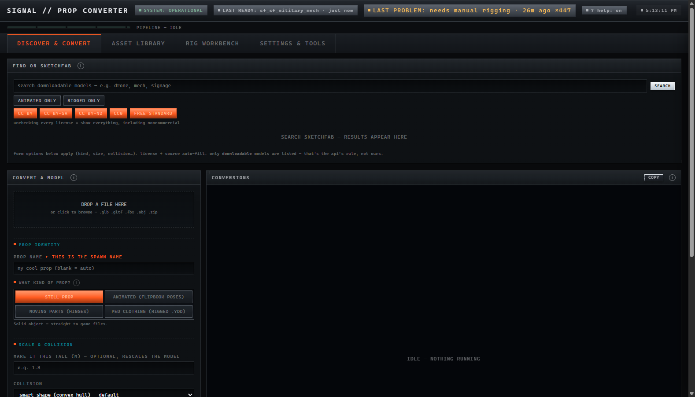
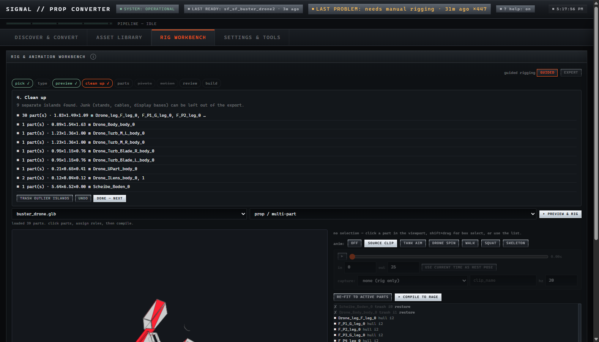
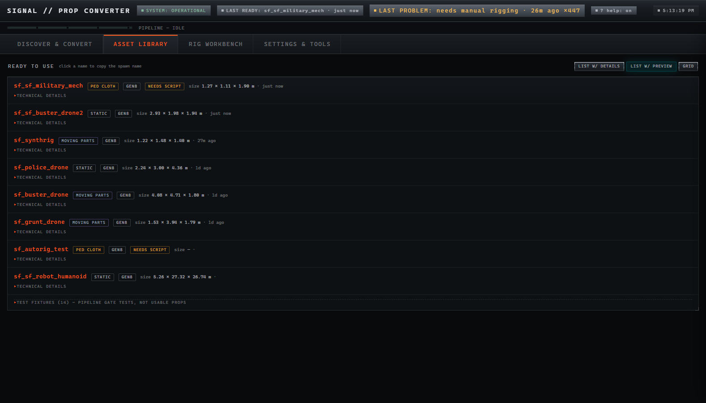
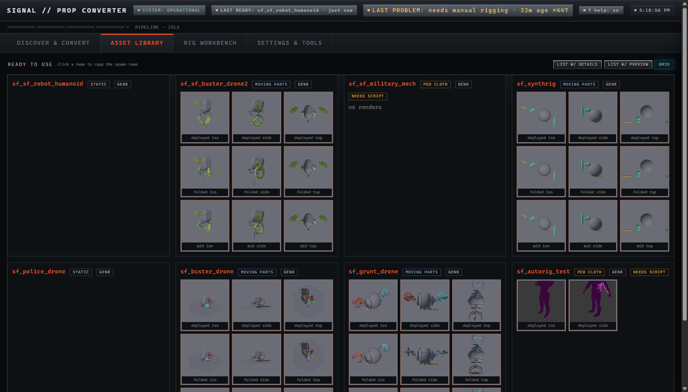
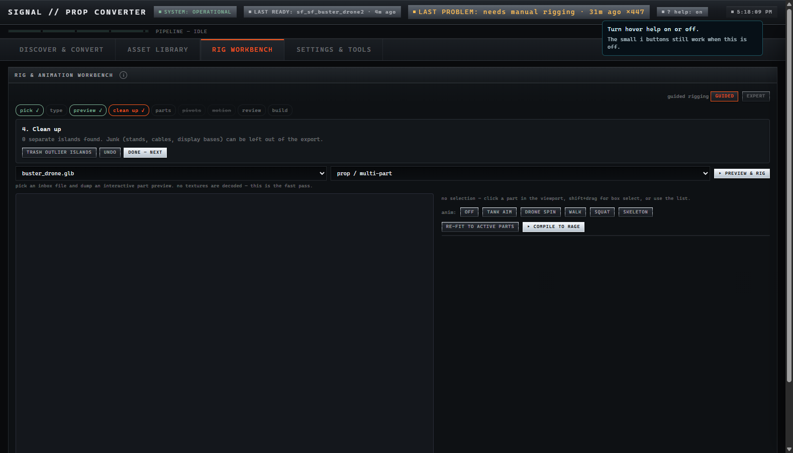
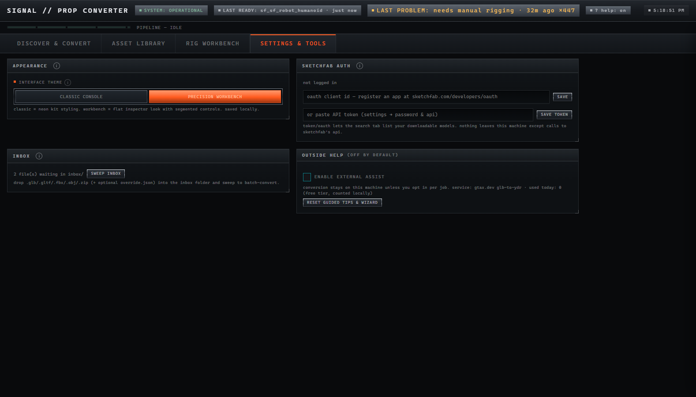

# Sketchfab → FiveM Asset Pipeline

Headless converter: a `.glb`/`.gltf`/`.fbx`/`.obj` (or `.zip` containing one)
goes in, a ready-to-`ensure` FiveM resource comes out — or the job lands in
`quarantine/` with a machine-readable reason. Built for the CliffordWon server;
everything runs locally with **zero Python dependencies** (stdlib only) and
**zero network calls** — no hosted converter is ever contacted.

The contract of record is `PIPELINE_SPEC.json` (v1.1.0). `REVIEW_BUNDLE.md` is
a frozen point-in-time review snapshot — treat this README as the living map
and the spec as the normative rules. `MOTION_SPEC.md` covers the motion modes.

## What you need installed

| Dependency | Where it's expected | Notes |
|---|---|---|
| Blender 5.2.1 | auto-discovered under `C:\Program Files\Blender Foundation\Blender *\blender.exe`, else `PATH`, else `SFP_BLENDER_EXE` | Always `--background --factory-startup --python-exit-code 1`; GUI never opens |
| Sollumz 2.9.0 | Blender add-on dir | Probed into `build/toolchain_caps.json` on first orchestrator run (cached; delete to re-probe). Bundled deps verified: szio 1.3.0.dev9, pymateria 0.2.0 |
| texconv.exe | shipped at `bin/texconv.exe` | PNG → power-of-two DDS (BC1/BC3/BC7) with mipmaps; sha256 recorded in reports |
| Python 3.12 | PATH | stdlib only for orchestrator/dashboard/harness |

## File map — what each thing is, when to read it

| File | Role | Read/edit when |
|---|---|---|
| `orchestrator.py` | Entry point + lifecycle owner. Safe zip extraction, sidecar merge+validation, capability-probe loading, Blender subprocess (120s default), Gates 1–4b + manifest/lua gates, apparel layout, both-generation publish, registry | Changing gates, sidecar defaults, publish layout, CLI flags |
| `blender_worker.py` | Runs **inside** Blender. Normalization (EC_02–EC_10), prop + ped_clothing export paths, generation-aware `target_versions`, texture prep + texconv, motion modes, preflight lint, `--dump-preview` + `rig_recipe` compile paths, `worker_result.json` | Geometry/materials/collision/motion/export/rigging |
| `preview_bake.py` | Runs **inside** Blender (imported by `blender_worker.py --dump-preview`). Evaluated world-space bake → `preview_scene.json` for the Rig Workbench: per-part geometry, padded-AABB islands, role guesses, `source_anim` driver-matrix tracks | Preview bake; contract in `reference/RIG_WORKBENCH.md` |
| `dashboard.py` | Zero-dep web UI on `:8420`. Entire UI is one `PAGE = r"""..."""` string (HTML+CSS+JS — editing the page means editing that string; no static-file route exists). 4 tabs: Discover & Convert (Sketchfab search + convert form + jobs log), Asset Library (details table / preview cards / grid views of published props), Rig Workbench (`panel-rig` canvas part-rigging → `/api/preview` + `/api/compile-rig`, see `reference/RIG_WORKBENCH.md` and AGENTS.md for the required `rig_*` DOM IDs), Settings & Tools (Sketchfab auth, inbox sweep). Pinned header telemetry + collapsible problems rail + pipeline progress strip. Form → `override.json`, dismissals persist, test fixtures collapsed via `test` flag | UI/UX; reason wording lives in `human_reason()`; all JS-referenced element IDs must survive edits |
| `vendor/` | Vendored CSS kits inlined verbatim into `PAGE`: cybercore-css 0.3.0 (structure) + @laddtnov/cyberpunk-ui 0.11.1 (effects/terminal/progress), MIT | Re-inline when upgrading; see `vendor/README.md` for sources + layer order |
| `inspect_sollumz.py` | Probe: versions, operators, providers, RSC version constants, capability flags → `build/toolchain_caps.json` | Re-run after any Blender/Sollumz change |
| `test_harness.py` | End-to-end regression suite (synthetic + rigged fixtures, gates, quarantine paths) | Run after any worker/orchestrator change |
| `render_check.py` | Runs **inside** Blender post-publish. Re-imports each emitted `.ydr.xml` via Sollumz, prints `[MESH]` UV/color counts, renders iso/side/top PNGs + `_assembly_{folded,deployed}` composites from `assembly_manifest.lua.json` | Visual verification; advisory only (`WARN_RENDER_CHECK`) |
| `PIPELINE_SPEC.json` | Normative contract v1.1.0: EC_01–EC_10, gates, sidecar schema, error/warning codes | The rules live here |
| `MOTION_SPEC.md` | Motion-mode contracts (snapshot, multi-part, quarantined vehicle modes, conventions) | Motion work |
| `reference/RIG_WORKBENCH.md` | Rig & Animation Workbench contract: `preview_scene.json` / `rig_recipe.json` schemas, capture modes (`clip_slice`, `drone_reactive_flight`), multi-instance naming (`<asset>_<role>_<idx>`) | Rig workbench + recipe changes |
| `reference/RAGE_SOLLUMZ_CONTRACTS.md` | Measured Blender-5.2/Sollumz-2.9 invariants the worker relies on (attribute naming, bone math, NLA, transform contracts) | Before trusting any external Blender/Sollumz doc |
| `reference/GEOMETRY_TELEMETRY_AND_XRAY.md` | Geometry telemetry + x-ray diagnosis design notes | Workbench/x-ray work |
| `reference/GUIDED_UX_SPEC.md` | Guided-cleanup UX spec for the workbench | UI flow changes |
| `tools/diagnose_trs.py` | Blender-side TRS diagnostic run on a **shipped** resource: PASS1 muted-vs-active NLA divergence, PASS2 `.ydr` internal part-center offset, PASS3 lever-arm swing, PASS3b max-vertex manifest-vs-source reconstruction (indexed + chamfer), PASS4 mid-pose lerp-vs-source-truth | Verifying Contract A on real builds; chasing transform/motion bugs |
| `tools/rigid_plate_qa.py` | Welded-island QA on ped `.ydd`s: `CROSS_LATERAL_BIND`, `DISJOINT_KINEMATIC_SEAM`, `FK_PENETRATION`, `PART_BONE_MISMATCH` (uses `<asset>.partmap.json` for island→part attribution) | Verifying rigid-plate ped binds (mechs, armor) |
| `testing/` | Render evidence + audit trail: `PHASE2_DIAGNOSIS.md` (Phase-2 audit), `PHASE3_RESULTS.md` (Phase-3 fixes + measured results), `REFERENCE_*.jpg` Sketchfab previews for render comparison | Reviewing QA history; comparing renders |
| `.devin/skills/` | Agent skill packs: `sketchfab-pipeline` (canonical invariants + QA order) + vendored `blender-*` reference packs — see "Agent skills" in AGENTS.md | Any agent working on the converter |
| `REVIEW_BUNDLE.md` | Frozen review snapshot | Historical; don't edit |
| `bin/texconv.exe` | Vendored DDS converter | Replace only with same-CLI builds |

## Data flow — one job, start to finish

```
inbox/ or --file <path>
        │  process_source()
        ▼
sha256 source → job_id → work/<job_id>/{raw,stream,textures}
        │  sidecar (beside input; inside-zip wins); malformed → quarantine
        │  zip: every member validated BEFORE extract (traversal/nested/size caps)
        │  magic-byte sniff vs claimed extension
        ▼
classify: prop | ped (+ apparel_pack) × target_generation legacy|enhanced|both
        │  conflicts → ERR_ASSET_TYPE_CONFLICT / ERR_TARGET_GENERATION_UNSUPPORTED
        ▼
blender --background --factory-startup --python-exit-code 1 --python blender_worker.py -- work/<job_id>
        │  EC_02–EC_10 normalization + Sollumz export; writes worker_result.json
        ▼
worker SUCCESS?  no → QUARANTINE (ERR_WORKER_FAILED)
        ▼ yes
Gate 1 (every binary: size + RSC7 + version==probed constant for its gen)
Gate 2 (prop: .ytyp declares every .ydr + collision iff requested;
       ped: .ydd.xml is a non-empty drawable dictionary)
Gate 3 dims [0.02,80] → Gate 4 name → Gate 4b archetypes
manifest gate (every quoted path resolves; lua54 absent) → lua gate
        ▼ pass
render_check (advisory): Sollumz re-import + iso/side/top PNGs + assembly
        composites; WARN_RENDER_CHECK on failure, never quarantines
        ▼
stage complete resource(s) → atomic rename → registry → work deleted
both-gen → TWO resources: <name> (gen8) + <name>_g9 (gen9)
```

`work/<job_id>/` while running: `job.json`, `raw/`, `stream/` (natives + CWXML
`.xml` audit sidecars; `gen8/`+`gen9/` subtrees when `target_generation=both`),
`textures/`, `lua_out/`, `worker_result.json`, `blender_stdout.log`. On failure
the whole dir moves to `quarantine/<job_id>/` with `failure_report.json`.

## Directory contract

| Dir | Meaning |
|---|---|
| `inbox/` | Drop `.glb/.gltf/.fbx/.obj/.zip` (+ optional `override.json`) |
| `work/` | Per-job scratch — deleted on publish, moved to quarantine on failure |
| `quarantine/<job_id>/` | Failed job + `failure_report.json` (`status`,`reason`,`extra`,`time`) |
| `build/resources/[sketchfab_props]/<resource>/` | Published resource(s) |
| `build/asset_registry.json` | name → `{source_sha256, archetypes, resource_dir(s), asset_type, target_generation, provenance, runtime_validation, built_at}` |
| `build/toolchain_caps.json` | Cached capability probe output |
| `build/dashboard_dismissed.json` | Dashboard dismissal persistence |
| `build/sketchfab_token.json` | Pasted Sketchfab API token (`SFP_SKETCHFAB_TOKEN` env overrides); fallback when OAuth isn't configured — search is tokenless |
| `build/sketchfab_oauth.json` | Per-operator OAuth client_id + access token (Implicit grant, loopback `http://127.0.0.1:8420/sf_oauth_cb`); each user logs in with their own Sketchfab account — nothing under `build/` is ever committed |
| `build/attribution_log.jsonl` | One JSON line per Sketchfab download: `{uid, model, creator, license, viewer_url, asset_name, time}` — attribution bookkeeping, also carried into each build_report via the override |

## Running it

```sh
python orchestrator.py --file path\to\model.glb   # one file
python orchestrator.py                            # sweep inbox once
python orchestrator.py --watch                    # poll inbox forever
python orchestrator.py --file big.glb --timeout 300
python inspect_sollumz.py                         # (via blender) refresh toolchain_caps.json
python dashboard.py                               # http://127.0.0.1:8420
```

## Dashboard screenshots

| | |
|---|---|
|  |  |
|  |  |
|  |  |

## `override.json` — every knob (all optional)

| Field | Default | Effect |
|---|---|---|
| `asset_name` | slug of filename | Final name; forced to `sf_*` matching `^[a-z0-9_]{3,48}$` |
| `asset_type` | `"prop"` | `"prop"` or `"ped"` — **never guessed**; ped → `.ydd` skinned dictionary path |
| `target_generation` | `"legacy"` | `legacy` (GEN8) / `enhanced` (GEN9) / `both` (two resources, `+_g9`) |
| `target_height_meters` | null | Uniform-scale so bbox Z equals this |
| `scale_multiplier` | 1.0 | Extra uniform scale |
| `rotation_offset_deg` | [0,0,0] | World rotation before export |
| `pivot_mode` | `bottom_center` | `bottom_center`/`center`/`keep_origin` |
| `split_multi_prop` | false | Each mesh → `<name>_NN` (cap 25) — prop only |
| `collision_mode` | `convex_hull` | `box`/`convex_hull`/`mesh_decimated`/`none`; ped requires `none` |
| `max_triangles` | 35000 | prop: decimate≤6×; ped: any overage → hard fail (no decimation on weights) |
| `max_texture_res` | 2048 | Downscale cap, POW2 preserved |
| `texture_mode` | `embed` | `embed` = DDS inside; `ytd` = external `<name>_txd.ytd` |
| `lod_dist` / `hd_texture_dist` | 150.0 / 60.0 | Archetype LOD distances (prop) |
| `archetype_flags` | "32" | ytyp flags (prop) |
| `require_weights` | true | ped: zero effective weights → `ERR_PED_NO_WEIGHTS` |
| `clothing_fix` | `{}` | `{"normal_push_meters": 0.003}` displaces verts along normals (anti-clip); `{"cloth": true}` → `ERR_PED_CLOTH_PHYSICS_UNSUPPORTED` |
| `apparel_pack` | false | Requires `apparel_config`; emits `fullDlc^comp` layout + shop meta + subdir_file_mapping manifest |
| `apparel_config` | null | `{"ped":"mp_m_freemode_01","dlc":"mydlc","components":[{"component":"jbib","index":0,"textures":1}]}` — **one component per job** |
| `motion_config` | `{}` | See MOTION_SPEC.md (`keep_actions`, `part_map` list/dict, `assembly_config`) |
| `rig_recipe` | null | Workbench recipe (`{parts, preview_transform, user_transform, anim_capture}`) — overrides `part_map`; roles → co-moving clusters, `trash` deletes parts, same-role multi-clusters export as `<asset>_<role>_<idx>`. See `reference/RIG_WORKBENCH.md` |
| `exclude_objects` | `[]` | fnmatch patterns on object names — matched objects + subtrees dropped (Sketchfab display bases/env junk) |
| `license` / `source_url` / `attribution` | null | Provenance → build_report + registry |
| `max_zip_members` / `max_zip_extract_bytes` | 512 / 512 MiB | Zip safety caps |
| `blender_timeout_s` | 120 | Per-job Blender subprocess timeout |

## Ped clothing (`asset_type:"ped"` or `motion_mode:"ped_clothing"`)

Rigged models convert to a **skinned drawable dictionary `.ydd`** — never a prop
`.ydr`/`.ytyp`. Requirements (each has a code, none are silently relaxed):

- Exactly **one armature** (`ERR_PED_NO_ARMATURE` / `ERR_PED_MULTI_ARMATURE`).
- Vertex-group names must match bone names (`ERR_PED_SKELETON_MISMATCH`).
- Effective weights present (`ERR_PED_NO_WEIGHTS`, or `require_weights:false` →
  `WARN_PED_MESH_UNWEIGHTED`); >4 influences truncated (`WARN_WEIGHT_INFLUENCES_TRUNCATED`).
- Meshes must be armature-skinned (modifier added if missing); normalization
  rigid-maps mesh verts **and** armature rest bones by the same matrix — the
  only `edit_bones` write the pipeline makes (head/tail + roll compensation).
- Exported skeleton is sanity-checked against mesh bounds in the `.ydd.xml`
  (`ERR_PED_TRANSFORM_MISMATCH`).
- **Unsupported, by design**: cloth physics/.yld (`ERR_PED_CLOTH_PHYSICS_UNSUPPORTED`),
  `.ymt` emission (`ERR_PED_APPAREL_YMT_UNSUPPORTED`), vehicle-rig motion modes.
- Ped output `runtime_status` is `downstream_consumer_required` — a `.ydd` is a
  dictionary of drawables; making it spawnable/wearable needs a consumer
  (apparel meta + `^`-naming, or a script that requests the drawable).

`apparel_pack:true` additionally emits the verified working-pack layout:
`stream/<fullDlc>/<fullDlc>^<comp>_<idx>_u.ydd` (+ `^<comp>_diff_*_uni.ytd`),
a `<ped>_<ped>_<dlc>_shop.meta` `ShopPedApparel` file, and a manifest with
`dependency '/policy:subdir_file_mapping'` + `data_file 'SHOP_PED_APPAREL_META_FILE'`.
Because a registerable pack needs a `.ymt` the toolchain cannot emit, apparel
jobs **currently quarantine at publish time** with `ERR_PED_APPAREL_YMT_UNSUPPORTED`
(the `.ydd` still converts first — check `quarantine/<job>/stream/`).

## Target generation

- `legacy` → GEN8 binaries (what most servers run). Default.
- `enhanced` → GEN9 (szio `NATIVE_GEN9` provider, probed present in 2.9.0).
- `both` → szio writes `gen8/` + `gen9/` subtrees; published as two resources
  `<name>` and `<name>_g9` — no ambiguous overwrites.
- Gate 1 checks the **uint32 at offset 4** against the probed `RSC_VERSION`
  constant for each extension+generation — RSC7 magic alone proves nothing.
- GEN9 output is format-verified only; no runtime (in-game) verification has
  been performed → recorded in `unresolved_limitations`.

## Validation gates

| Gate | Check | Code |
|---|---|---|
| 0 (worker) | expected native file exists, non-empty, RSC7 | `ERR_EXPORT_ARTIFACT_MISSING` |
| 1 | every `.ydr/.ydd/.ytd/.ytyp`: size floor + RSC7 + version field == probed constant | `ERR_GATE1_RSC7_INVALID`, `ERR_GATE1_RSC_VERSION_MISMATCH`, `ERR_GATE1_YTD_MISSING_OR_NOT_RSC7` |
| 2 | prop: `.ytyp` bin+xml declare every `.ydr` + collision iff requested; ped: `.ydd.xml` non-empty dictionary | `ERR_GATE2_YTYP_INVALID`, `ERR_GATE2_YDD_INVALID`, `ERR_COLLISION_MODE_UNSUPPORTED` |
| 3 | dims ∈ [0.02, 80.0] m | `ERR_GATE3_DIMS_OUT_OF_RANGE` |
| 4 | name not registered under different source hash | `ERR_GATE4_NAME_COLLISION` |
| 4b | no emitted archetype collides elsewhere | `ERR_GATE4_ARCHETYPE_COLLISION` |
| manifest | every quoted resource path resolves; no `lua54` | `ERR_MANIFEST_UNRESOLVED` |
| lua | generated `.lua` loadfile-checked (if `lua` on PATH) | `ERR_LUA_SYNTAX` / `WARN_LUA_SYNTAX_UNVERIFIED` |

### QA tooling (deeper than the gates)

The binary-format gates prove the files are structurally RAGE — they can't see
bad transforms, wrong bone binds, or junk source geometry. Two tools run inside
Blender against the *published* output for that:

- `tools/diagnose_trs.py <res_dir>` — reconstructs the manifest pose from the
  shipped `.ydr` data and compares it to the evaluated source animation at
  `f_start` and the true mid-frame. Catches pivot/contract bugs at millimetre
  precision (PASS3b reads `0.0000m` on a correct build).
- `tools/rigid_plate_qa.py <path/to.ydd>` — welds the exported ped dictionary
  and audits islands: cross-lateral binds, kinematic seams >1 joint apart,
  FK penetration, part↔bone mismatches (attributed via `partmap.json`).

Run order after any transform/export change: `test_harness.py` →
`diagnose_trs.py` → `rigid_plate_qa.py` → compare `render_check` PNGs against
`testing/REFERENCE_*.jpg`. See `.devin/skills/sketchfab-pipeline/SKILL.md` for
the full gate contract.

## Publish output

```
build/resources/[sketchfab_props]/<name>/
├── fxmanifest.lua            # prop: DLC_ITYP_REQUEST; ped: bare; apparel: meta+files{}
├── stream/                   # .ydr|.ytyp|.ytd|.ydd + .xml audit sidecars
│   ├── <asset>.partmap.json  # ped w/ parts: pre-join island→part map for rigid_plate_qa
│   └── (apparel: stream/<fullDlc>/<fullDlc>^comp_000_u.ydd ...)
├── <motion manifest>.lua     # motion modes only
├── <ped>_<ped>_<dlc>_shop.meta   # apparel only
└── build_report.json         # full schema in PIPELINE_SPEC.json
```

`runtime_validation` is always `"NOT_PERFORMED"` unless a real FXServer
staging run happened — Blender-side gates prove format, not gameplay.

## External converters — opt-in assist only

The pipeline is **local-only by default**: every automated job runs Blender +
Sollumz + texconv on this machine, and a failed local conversion quarantines
normally — never a silent switch.

One narrow opt-in exception exists: after a *static prop* fails locally, the
dashboard's failure card offers "Try an outside converter" (default: the
gtax.dev glb→ydr service). It activates only when **all** of these hold:

- the Settings → "outside help" master switch is on (default **off**);
- the failed asset is a static prop with an eligible error
  (`ERR_WORKER_FAILED`, `ERR_EXPORT_ARTIFACT_MISSING`, `ERR_GATE1_*`,
  `ERR_GATE2_YTYP_INVALID`);
- the local "fix it" guidance has already been shown;
- you tick the per-job consent checkbox (never remembered) and click send.

Exactly what leaves the machine is stated on the card: the source `.glb`,
its size, and its licence. The API key (if any) lives server-side in
`setup.json`/`build/xa_config.json`/`GTAX_API_KEY` — never in the browser.
Returned files are integrity-checked (RSC7 magic + size floors) and
name-collision-checked before publish, carry
`provenance.external_assist` + `runtime_validation: NOT_PERFORMED` in
`build_report.json`, and get an `EXTERNAL TOOL` badge in the library. They
are never treated as validation of the local build.

`gtax-dev/v-drawable-to-glb` remains diagnostic-only manual use.

## Deploying an asset into the server (last mile is manual)

1. Copy `build/resources/[sketchfab_props]/<name>/` → `server-data/resources/[assets]/<name>/`
2. `ensure <name>` in server.cfg
3. Restart FXServer; props spawn via `CreateObject` (snippet in build_report).
   Ped `.ydd` is not directly spawnable — it needs the apparel pipeline or a
   drawable-loading consumer (`downstream_consumer_required`).

Rights: output inherits the `[assets]` dev-load posture — test locally; don't
distribute until the source license clears (provenance fields exist so this is
recorded at build time).

## Debugging a quarantined job

1. `quarantine/<job_id>/failure_report.json` → `reason` + `extra`
2. `.../blender_stdout.log` → Blender/Sollumz trace
3. `.../worker_result.json` → `errors[]` + `warnings[]` + `inspect`
4. `.../raw/` → what the importer saw
5. Dashboard PROBLEMS → human headline + suggestion (dismiss ≠ delete)

## Gotchas

- Re-running the identical source is idempotent. Same name + different content
  → Gate 4 quarantine; rename via `asset_name` or delete the old registry entry.
- `.xml` CWXML sidecars ship for audit; FiveM ignores them.
- `--factory-startup` ⇒ Sollumz enabled *in code* each run.
- The capability report is **cached** at `build/toolchain_caps.json` — delete
  it after any Blender/Sollumz change to force re-probe.
- Apparel filenames use `fullDlc^component` — that's FiveM's documented
  subdir-mapping convention, not an archetype name (the `sf_` rule doesn't apply).
- Jobs are serial; Blender is a subprocess, not a service.
